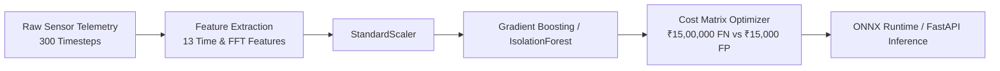

# Pillar 3: Predictive Maintenance MLOps Engine (Indian Commercial Fleet Edition)

A production-grade machine learning pipeline for real-time equipment failure prediction from automotive vibration and sensor telemetry streams, optimized for Indian commercial vehicle fleets (Tata Motors, Ashok Leyland, Mahindra, BharatBenz).

---

## 🏗️ Architecture & Signal Processing



### 1. Extracted Signal Descriptors (`src/feature_extraction.py`)

| Feature Type | Metrics Computed | Physical Meaning |
| :--- | :--- | :--- |
| **Statistical Moments** | RMS, Peak-to-Peak, Variance | Overall energy distribution and dynamic range of vibration across highway transit. |
| **Dimensionless Ratios** | Crest Factor, Shape Factor, Impulse Factor, Margin Factor | Highly sensitive to early bearing race spalling and impact degradation. |
| **Shape Moments** | Skewness, Kurtosis (Fisher's Excess) | Asymmetry and tail peakedness. Kurtosis $> 4.0$ flags localized mechanical impact. |
| **Spectral (FFT)** | Spectral Energy, Centroid, Spread | Frequency centroid shifts under unbalanced rotational load. |

### 2. Physical Incipient Fault Archetypes vs Nominal Operating Envelopes

To model realistic industrial equipment telemetry, faults must not be trivially separable. In early stages (Stage 1/Stage 2 degradation), damage manifests as subtle deviations that overlap with healthy operating modes under heavy Indian payload conditions:

- **Nominal Operating Envelope**: Frequency $45\text{–}75\text{ Hz}$, load amplitude $0.6\text{–}1.4$, sensor noise $\sigma \in [0.10, 0.35]$.
- **Incipient Bearing Micro-Pitting (Type 0)**: Intermittent transients ($\pm 1.4\text{–}2.2$ amplitude) yielding kurtosis in the $2.5\text{–}5.0$ range, partially overlapping noisy healthy baselines.
- **Incipient Combustion Misfire (Type 1)**: Mild $18\text{ Hz}$ resonant wobble ($\text{RMS } \approx 0.95\text{–}1.30$), overlapping high-load healthy cycles.
- **Incipient Friction / Cavitation (Type 2)**: Subtle $110\text{ Hz}$ harmonic distortion shifting spectral centroids without blowing out total energy.

---

## 💰 Cost-Sensitive Threshold Optimization (`src/train.py`)

Standard 0.50 probability thresholds fail in industrial environments because classification errors have asymmetric economic consequences for Indian logistics and transport fleets:

- **False Negative (FN)**: Uncaught mechanical breakdown $\rightarrow$ Catastrophic engine/transmission teardown & highway recovery on Golden Quadrilateral / NH-44: **₹15,00,000 (₹15 Lakhs)**
- **False Positive (FP)**: False alarm $\rightarrow$ 30-minute workshop sensor diagnostic scan at authorized depot: **₹15,000**
- **Cost Ratio**: A False Negative is **100x** more expensive than a False Positive.

By sweeping decision thresholds $\tau \in [0.05, 0.95]$ against the business loss function:

$$\text{Total Cost} = (\text{FN} \times ₹15,00,000) + (\text{FP} \times ₹15,000)$$

Due to feature overlap in early-stage degradation, lowering the decision threshold from $\tau = 0.50$ down to $\tau^* \approx 0.08\text{–}0.10$ captures subtle catastrophic failures at the expense of a modest increase in routine shop inspections, yielding over **₹1,33,65,000 (₹1.33+ Crores)** in net cost avoidance per 1,000 fleet test cycles.

---

## 🚀 Execution Instructions

### 1. Install Dependencies
```bash
pip install -r requirements.txt
```

### 2. Train and Optimize
```bash
python src/train.py
```

### 3. Export to ONNX for Edge Deployment
```bash
python src/export_onnx.py
```

